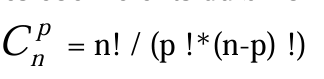

# Exercice 4

Les coefficient du binôme de Newton peuvent être calculés récursivement grâce à la formule du triangle de Pascal : 

## a
Ecrire une fonction CoeffBinome récursive qui calculera les coefficients du binôme de Newton

## b
Ecrire une version itérative de CoeffBinome sachant que : 

## c
Le programme devra finalement afficher le résultat du calcul du binôme de Newton pour les valeurs x,y et n rentrées par l'utilisateur.

Pour le calcul de la puissance, écrire une fonction itérative qui permet de calculer la puissance de 2 nombres passés en paramètres (puissance(x,y)=x^y)

Ex : x=2 , y=3, n=4 => résultat = 625